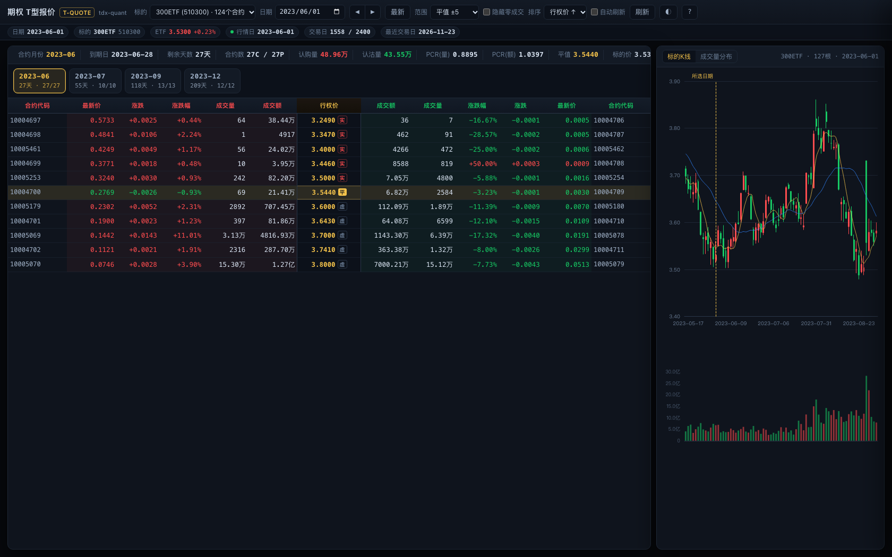
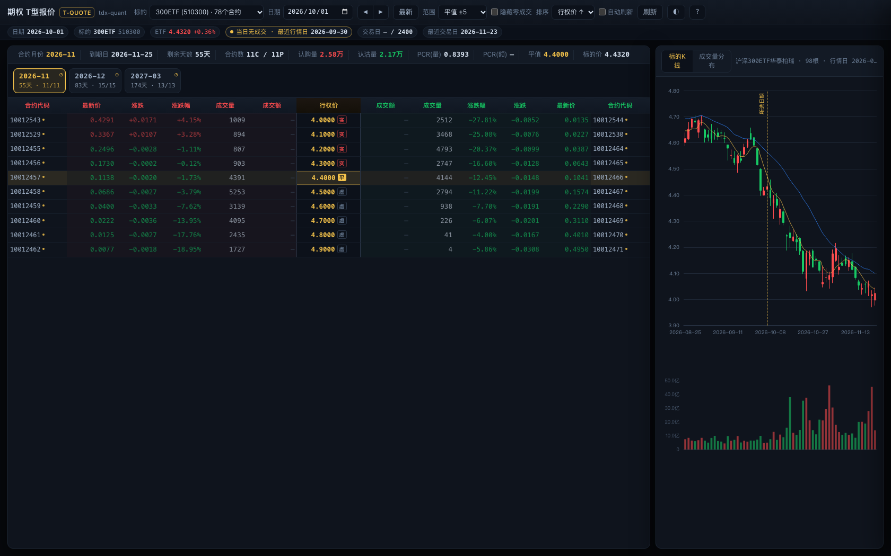
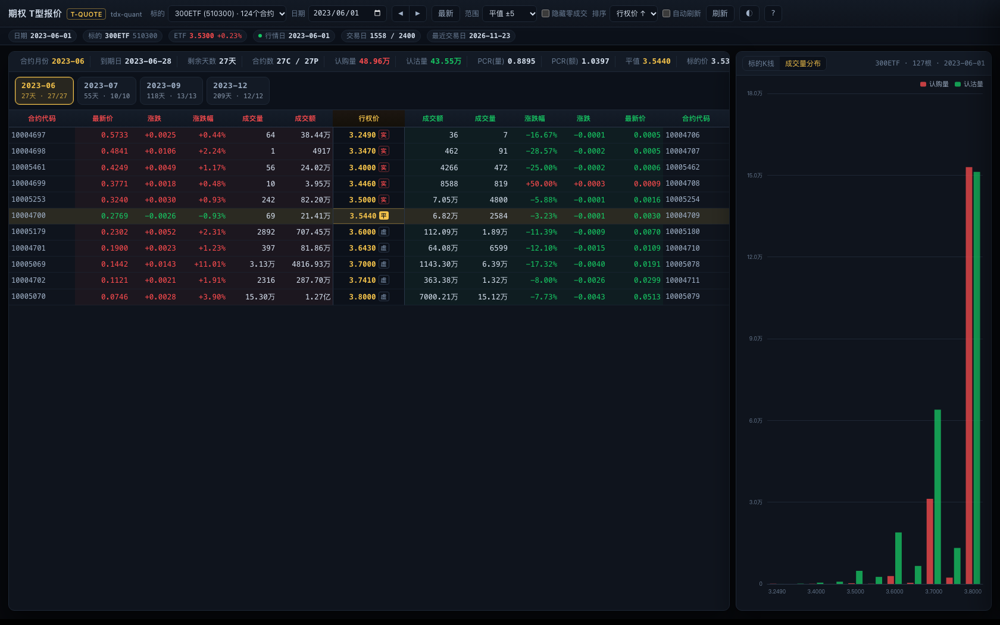

# 期权 T型报价 —— 企业级设计方案 & 实现说明

> 新增：`GET /api/option/listOptionInDate`（指定日期 → 合约分组）+ 期权T型报价单页
> 页面：`/option/option-tquote.html`（`http://localhost:7001/option/option-tquote.html`）
> 参考 UI：通达信「期权T型报价」
> 代码：`OptionController` / `OptionService(+Impl)` / `ConvertOptionTQuote` / `BaseOptionMapper(+XML)` / `OptionQuoteDTO` 等

---

## 1. 需求与实现映射

| 需求 | 实现 |
|---|---|
| ① `GET /api/option/listOptionInDate?date=2026-10-01` → 合约分组列表（合约月份 - 认购/认沽） | `OptionController#listOptionInDate`，返回 `List<MonthOptionDTO>`；每个月份含 `callDtoList` / `putDtoList` / `strikeList` / 月度统计 / 派生指标。另支持可选 `underlyingCode` 过滤 |
| ② 新增「期权T型报价」HTML 单页面（UI 参考通达信截图） | `static/option/option-tquote.html`（原生 HTML+CSS+JS 单文件，无外部 CDN）；深色终端风格；认购/认沽 双向镜像 + 中间行权价对齐；顶栏/状态条/月份Tab/统计条 |
| ③ 筛选月份 → 替换成 筛选日期 | 顶栏「日期」选择器（+ 上一/下一交易日、最新）；月份改为 **Tab 自动分组**（由所选日期推导），选中月份仅做展示切换，不重新请求 |
| ④ 右上角显示 标的ETF 对应日期（前后3个月）行情K线 | 右侧卡片「标的K线」：`GET /api/option/underlyingKline?underlyingCode=&date=&months=3` → 蜡烛图 + MA5/MA20 + 成交量 + **所选日期竖线**；可切「成交量分布」 |
| ⑤ 完善未提到的功能 | 合约K线弹窗（点击合约代码）、派生指标（内在价值/时间价值/盈亏平衡/杠杆/实平虚/距平值档数）、月度 PCR、平值附近过滤、隐藏零成交、排序、CSV 导出、URL 状态同步、键盘快捷键、深浅主题、自动刷新、加载/空/错误态、数据缺口提示 |

---

## 2. 接口设计（5 个）

统一返回 `Result<T>`：`{ data, success, code, msg }`。

### 2.1 `GET /api/option/listOptionInDate` ★ 需求①

| 参数 | 类型 | 必填 | 说明 |
|---|---|---|---|
| `date` | `yyyy-MM-dd` | 否 | 指定日期；不传 = 今天 |
| `underlyingCode` | String | 否 | 标的 code（如 `510300`）；不传 = 全部标的 |

响应 `List<MonthOptionDTO>`（按 标的 + 合约月份 升序）：

```json
[
  {
    "key": "510300-202610",
    "underlyingCode": "510300",
    "underlyingName": "300ETF",
    "contractMonth": 202610,
    "monthLabel": "2026-10",
    "expiryDate": "2026-10-28",
    "daysToExpiry": 27,
    "date": "2026-10-01",
    "quoteDate": "2026-09-30",
    "hasData": false,
    "underlyingClose": 4.4320,
    "underlyingChangePct": 0.36,
    "underlyingTradeDate": "2026-09-30",
    "callCount": 11,
    "putCount": 11,
    "strikeList": [
      4.0,
      4.1,
      4.2,
      4.3,
      4.4,
      4.5
    ],
    "atmStrike": 4.4000,
    "callVolume": 25839,
    "putVolume": 21686,
    "callAmount": 0,
    "putAmount": 0,
    "pcrVolume": 0.8393,
    "pcrAmount": null,
    "callDtoList": [
      {
        "code": "10012543",
        "name": "300ETF购11月4000",
        "callPutType": "C",
        "strikePrice": 4.0000,
        "contractMonth": 202611,
        "startDate": "2026-09-29",
        "endDate": "2026-11-23",
        "expiryDate": "2026-11-25",
        "daysToExpiry": 55,
        "barDate": "2026-09-30",
        "stale": true,
        "open": 0.4269,
        "high": 0.4308,
        "low": 0.4103,
        "close": 0.4291,
        "prevClose": 0.4291,
        "volume": 1009,
        "amount": 0.00,
        "changePrice": 0.0000,
        "changePct": 0.00,
        "rangePct": 0.00,
        "intrinsicValue": 0.4320,
        "timeValue": -0.0029,
        "breakEven": 4.4291,
        "leverage": 10.3286,
        "moneyness": "ITM",
        "otmLevel": -4
      }
    ],
    "putDtoList": [
      ...
    ]
  }
]
```

> `callDtoList` / `putDtoList` 保留原 `MonthOptionDTO` 的字段名，但元素由 `BaseOptionDO` 改为**纯报价 DTO** `OptionQuoteDTO`：实体里的 `klineHis(blob)` / `getKlineHisStr()` 会导致响应体被整段K线 JSON 撑爆（数十 MB），因此 API 一律不返回实体。

### 2.2 `GET /api/option/underlyingList?date=`

指定日期 存续合约的标的概况（含标的ETF 行情），用于顶栏「标的」下拉与状态条：

```json
[{"underlyingCode":"510300","underlyingName":"300ETF","etfName":"沪深300ETF华泰柏瑞",
  "contractCount":124,"monthCount":4,"startDate":"2026-04-23","endDate":"2027-06-23",
  "tradeDate":"2026-11-23","close":4.0230,"prevClose":3.9970,"changePrice":0.0260,"changePct":0.65,
  "missingEtfKline":false}]
```

### 2.3 `GET /api/option/underlyingKline?underlyingCode=&date=&months=3`

标的ETF K线（默认前后 3 个月），供右上角图表：

```json
{"underlyingCode":"510300","underlyingName":"300ETF","etfName":"沪深300ETF华泰柏瑞",
 "date":"2026-10-01","from":"2026-07-01","to":"2027-01-01","months":3,
 "quoteDate":"2026-09-30","close":4.4320,"prevClose":4.4160,"changePrice":0.0160,"changePct":0.36,
 "barCount":98,"klineList":[{"date":"2026-07-01","open":4.55,"high":4.60,"low":4.52,"close":4.58,"vol":12345678,"amo":5.6E7,"rangePct":1.77,"changePct":0.66,"changePrice":0.03}]}
```

### 2.4 `GET /api/option/kline?code=`

单合约 K线（详情抽屉 / 合约K线跳转）：`{code,name,callPutType,strikePrice,contractMonth,startDate,endDate,multiplier,underlyingCode,underlyingName,barCount,klineList}`

### 2.5 `GET /api/option/tradeDates?underlyingCode=&from=&to=`

交易日历（升序 `List<LocalDate>`，取自标的ETF 日K）→ 前端做「上一/下一交易日」、日期合法性校验、交易日序号展示。

---

## 3. 后端实现

### 3.1 分层与类清单

| 层 | 类 | 说明 |
|---|---|---|
| Controller | `OptionController` | 5 个新接口（+ 保留 `/info`、`/blockInfo`） |
| Service | `OptionService(+Impl)` | T型报价组装、标的列表、合约/标的K线、交易日历；**Caffeine 缓存** |
| Convert | `ConvertOptionTQuote`（新） | 纯函数：`kline_his` 解析、二分定位「≤日期的最近一根」、按标的+月份分组、行权价对齐、月度统计、派生指标；含 `main()` 自测 |
| DAL | `IBaseOptionService(+Impl)` | `listOptionInDate(date, underlyingCode)`、`klineHisMapInDate`、`getUnderlyingName` |
| Mapper | `BaseOptionMapper(+XML)` | `listSimpleInDate(date, underlyingCode)`、`listKlineHisInDate(date, underlyingCode)`、`getUnderlyingName` |
| DTO | `MonthOptionDTO`（扩展）、`OptionQuoteDTO`（新）、`OptionUnderlyingDTO`（新）、`OptionKlineDTO`（新）、`OptionUnderlyingKlineDTO`（新） | API 输出，均不含 blob |

### 3.2 请求链路（T型报价）

```
GET /api/option/listOptionInDate?date&underlyingCode
  ├─ Caffeine 缓存命中（key = date|underlyingCode，TTL 60s）→ 直接返回
  ├─ ① listSimpleInDate(date, underlyingCode)           // 存续合约（无 blob，≤ 千行）
  ├─ ② klineHisMapInDate(date, underlyingCode)          // code -> kline_his 解压后 JSON
  ├─ ③ 各标的 ETF 当日K线（Caffeine 5min 缓存，取 ≤date 最近一根 + 重算涨跌）
  ├─ ④ 交易日历（ETF 日K 日期，用于到期日顺延）
  └─ ⑤ ConvertOptionTQuote.build(...)  → List<MonthOptionDTO>
```

**性能**：单标的（如 300ETF 124 个合约）首次约 0.3~0.6s（含 124 个 blob 解压 + 组装 20ms），之后命中缓存；`date+underlyingCode` 维度 60s TTL，历史日期基本恒定。索引：`idx_stock_code(underlying_code)`，8842 行全表扫描也仅数十毫秒。

### 3.3 关键口径（踩坑与处理）

| 问题 | 现象 | 处理 |
|---|---|---|
| **合约「存续」判定** | 现网 `KlineServiceImpl#convertOptionDO` 曾把存续合约的 `end_date` 覆写成「最后一根K线日期」（全部 = 2026-11-23），导致 `date <= end_date` 在今天漏掉全部存续合约 | ① SQL 判定放宽为 `date <= max(end_date, 合约月份月末)`；② Java 侧用 **有效到期日 = max(end_date, 合约月份第4个星期三 遇节假日顺延)** 精确过滤；③ 顺手修复 `KlineServiceImpl`（不再覆写 `end_date`），**未改动任何存量数据** |
| **涨跌幅/涨跌额/振幅恒为 0** | 通达信导出的 `kline_his` 这三项全部是 `0.00000`（历史 Excel 导入的有真实值） | 组装时统一用「上一根收盘」重算 `涨跌额/涨跌幅`、用 `H/L` 重算 `振幅`，两类数据口径一致 |
| **成交额缺失** | 通达信导出的存续合约 kline 不含成交额（`amo=0`） | 保留原值（0），前端在 `vol>0 && amount=0` 时显示 `—` 并提示「数据源未提供成交额」；PCR(额) 自动为 `—` |
| **数据缺口** | 2026-01-01 ~ 2026-04-22 无期权行情 | 日期落入该区间时页面顶部黄色横幅提示，并展示「最近行情日」快照 |
| **首根 K 线无昨收** | — | 用 kline 内的 `涨跌额` 反推 `prevClose`；`kline_his` 首根即上市首日（`pre_settle_price` 口径） |
| **标的ETF 日K 自 2017-01-03 起** | 更早日期无标的价 | `intrinsicValue/timeValue/atmStrike/leverage` 为 `null`，前端显示 `—`，其余列正常 |

### 3.4 派生指标公式

| 指标 | 公式 |
|---|---|
| 内在价值 | 认购 `max(0, S-K)`；认沽 `max(0, K-S)`（S = 标的ETF 当日收盘） |
| 时间价值 | `close - intrinsicValue`（按原始数据计算，不做钳制，出现负值即数据套利/失真信号） |
| 盈亏平衡 | 认购 `K + close`；认沽 `K - close` |
| 杠杆 | `S / close` |
| 实/平/虚 | 平值 = 最接近 S 的行权价；认购 `S>K` 实值、`S<K` 虚值；认沽相反 |
| 距平值档数 | `otmLevel` = 行权价在升序 `strikeList` 中与平值行权价的下标差（认购取正/认沽取负）→ 正数=虚值档数 |
| PCR | `认沽成交量合计 / 认购成交量合计`（额同理，缺额时为空） |

---

## 4. 前端设计（`option-tquote.html`）

### 4.1 布局

```
┌─────────────────────────────────────────────────────────────────────────────┐
│ 顶栏：标的▾  日期📅 ◀ ▶ 最新  范围▾  隐藏零成交  排序▾  自动刷新  刷新 ◐ ? │
├─────────────────────────────────────────────────────────────────────────────┤
│ 状态条：日期 / 标的 / ETF价+涨跌 / 行情日(或"当日无成交") / 交易日序号       │
├──────────────────────────────────────────────┬──────────────────────────────┤
│ 统计条：月份 到期日 剩余天数 合约数 认购量 认沽量 PCR 平值 标的价            │
│ 月份Tab：[2026-11 55天] [2026-12 83天] [2027-03 174天]                       │
│ ┌──────────────────────────┬───────┬──────────────────────────┐  标的K线图  │
│ │ 认购：代码 最新价 涨跌 涨跌幅 量 额 │ 行权价 │ 额 量 涨跌幅 涨跌 最新价 代码 │  (±3月,MA,量)│
│ │ …（按行权价对齐，平值高亮，实/平/虚 标记）…                  │  成交量分布  │
│ └──────────────────────────┴───────┴──────────────────────────┘              │
└──────────────────────────────────────────────┴──────────────────────────────┘
合约详情抽屉（点击合约代码）：要素+派生指标 3列网格 + 合约日K线 + 复制/导出
```

### 4.2 对通达信截图的取舍

截图列（买量/买价/现价/持仓量/卖价/卖量…）依赖**五档盘口 + 持仓量**，而 `base_option` 仅存日K（无盘口、无持仓量，持仓量在历史导入时已确认丢弃）。因此：

| 通达信列 | 本页 | 原因 |
|---|---|---|
| 现价 / 涨跌幅 / 涨跌 | ✅ 最新价 / 涨跌幅 / 涨跌 | 日K 收盘 + 重算 |
| 持仓量 | ❌ → 用「成交量 + 成交额」 | 表内无 `open_interest` |
| 买量 / 买价 / 卖价 / 卖量 | ❌ | 无盘口数据 |
| 购/沽分区 + 行权价居中 | ✅ 完全对齐（含实/平/虚、平值高亮） | |
| 月份下拉筛选 | ✅ 改为**日期筛选 + 月份Tab** | 需求③ |

> 若后续接入实时行情（含五档/持仓量），只需在 `OptionQuoteDTO` 增列 + 表头加列，前端表格已按「认购/中间/认沽」三段渲染，扩展成本极低。

### 4.3 交互与体验

- **日期**：`date` 输入 + ◀▶ 交易日翻页 + 「最新」；超出最近交易日自动收敛并 toast；
- **范围**：全部 / 平值 ±3 ±5 ±10 ±20（默认 ±5，与截图信息密度一致）；「隐藏零成交」；
- **排序**：行权价 升/降；
- **点击合约代码** → 右侧抽屉：11 项要素 + 派生指标 + 合约日K（标出所选日期）+ 复制代码/导出CSV；
- **CSV 导出**：当前月份、按行权价对齐的认购/认沽 17 列（带 BOM，Excel 直接打开）；
- **键盘**：`←/→` 交易日、`1..9` 切月份、`r` 刷新、`Esc` 关抽屉；
- **URL 状态**：`?date=&underlying=&month=&range=` 可分享/回放；
- **主题**：深色（默认，贴近通达信）/浅色可切，`localStorage` 记忆；
- **自动刷新**：仅当所选日期 = 最近交易日时，每 60s 刷新（与后端缓存 TTL 对齐）；
- **异常态**：加载进度条、空态（含「2026-01~04 数据缺口」说明）、错误横幅 + 重试、`echarts` 缺失降级提示；
- **响应式**：≤1280px 收窄右栏；≤1080px 上下堆叠、表格横向滚动。

### 4.4 前端技术约束

- 纯原生（与项目其他页面一致）：`../js/config.js`（环境/API）+ `../js/echarts.min.js`（本地，无 CDN）；
- **后端调用统一走 `window.ApiUtils`（强制约定）**：

  ```js
  // 唯一出口：页面内不出现裸 fetch / 硬编码 host / 手拼 origin
  async function api(path, params) {
      var au = apiUtils();                                  // 未加载 config.js -> 抛错
      var url = path + buildQuery(params);                  // 只拼 路径 + query
      var res = await au.fetch(url, {signal: ctrl.signal}); // ApiUtils.fetch 内部 buildUrl(API_HOST)
      var json = await res.json();
      if (json.success === false) throw new Error(json.msg);
      return json.data;
  }
  ```

  | 约束 | 说明 |
  |---|---|
  | 唯一出口 | 只有 `api(path, params)` 一个函数发请求，内部固定 `ApiUtils.fetch(buildUrl(...))` |
  | 不拼 origin | 页面不判断 `location`、不硬编码 `localhost:7001`；环境由 `config.js` 的 `ENV_CONFIG` 决定 |
  | 未加载即报错 | `ApiUtils` 缺失时直接抛错 + 顶部红色横幅「未加载 static/js/config.js」+ 空态「接口入口未就绪」，避免静默请求到错误地址 |
  | 环境可见 | 帮助弹窗展示当前 `ENV` 与 `API_HOST`（`ApiUtils.getEnv()` / `ApiUtils.buildUrl('/')`），顶栏 brand `title` 显示示例接口完整 URL |
  | 跨域 | 后端 `CorsConfig` 已对 `/api/**` 放开 `allowedOriginPatterns("*")`，`127.0.0.1` ↔ `localhost` 混用不会失败 |

- 全部数值格式化在客户端完成（价格 4 位、量/额 万/亿、涨跌红涨绿跌 —— A股习惯）；
- 性能：单次渲染 ≤ 200 行；切月份/范围/排序均为纯前端重算，不发请求。

---

## 5. 界面截图（真实数据渲染）

**历史日期（2023-06-01，含真实成交额/涨跌幅）**



**当日快照（2026-10-01 为国庆非交易日 → 自动展示最近行情日 2026-09-30）**



**成交量分布（认购/认沽 按行权价）**



---

## 6. 验证记录（已执行）

| 项 | 方法 | 结果 |
|---|---|---|
| 编译 | `mvn -o -DskipTests compile` | ✅ 通过 |
| 组装逻辑单测 | `ConvertOptionTQuote.main()`（二分定位、月份标签、组装） | ✅ 通过 |
| 真实数据端到端 | JDBC 直连 + `ConvertOptionTQuote.build()`（2023-06-01 / 2026-10-01 / 2026-11-24） | ✅ 月份/到期日/持仓量统计/派生指标均正确；单标的 124 合约组装 20ms |
| 存续判定 | 2026-11-24（今日）→ 124 个存续合约（修复前为 0） | ✅ |
| 页面渲染 | Headless Chrome 截图（2026-10-01 / 2023-06-01） | ✅ 表格对齐、平值高亮、实/平/虚、K线、成交量分布 |
| 抽屉 | Headless Chrome 点击合约代码 | ✅ 合约详情 + 合约日K |
| 空/缺口态 | 日期切至 2026-02-15（数据缺口） | ✅ 横幅提示 + 最近行情日快照 |

---

## 7. 使用方式

```bash
# 1) 重新编译 + 重启应用（接口是新增的，运行中的进程需要重启才能生效）
mvn -o -DskipTests compile
# 或在 IDE 里重启 TdxQuantApp

# 2) 接口自测
curl -s "http://localhost:7001/api/option/listOptionInDate?date=2026-10-01&underlyingCode=510300" | head -c 400
curl -s "http://localhost:7001/api/option/underlyingList?date=2026-10-01"
curl -s "http://localhost:7001/api/option/tradeDates?underlyingCode=510300" | head -c 200

# 3) 打开页面（页面所有接口均通过 static/js/config.js -> ApiUtils 调用）
#    默认 ENV：localhost/127.0.0.1 -> dev_local -> API_HOST=localhost:7001
open "http://localhost:7001/option/option-tquote.html?date=2026-10-01&underlying=510300"
# 首页菜单：http://localhost:7001/index.html → 「期权T型报价」
```

---

## 8. 后续可扩展

1. **实时行情**：接入五档/持仓量后补「买量/买价/卖价/卖量/持仓量」列与实时刷新（当前为日频快照）；
2. **希腊字母 / IV**：历史 Excel 里有 delta/gamma/theta/vega/IV，建议另建 `base_option_greek` 日频表后加入表格（按需懒加载，避免响应膨胀）；
3. **最大痛点 / 持仓量PCR**：依赖持仓量，同上；
4. **T型报价 历史回放动画**：按交易日序列预取多日 → 前端回放（当前单日快照）；
5. **组合/策略入口**：与 `option-trade.html` 打通（选中行 → 一键填单），复用 `state.selectedContract` 逻辑。
